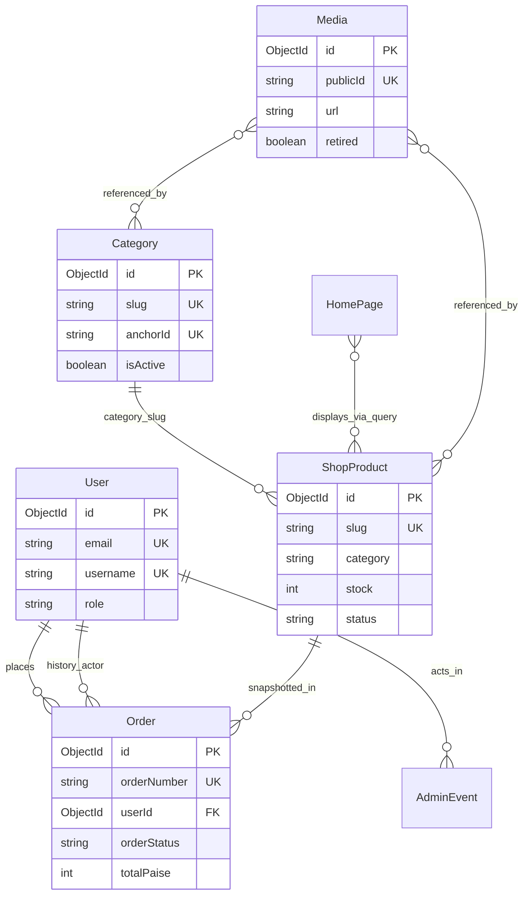
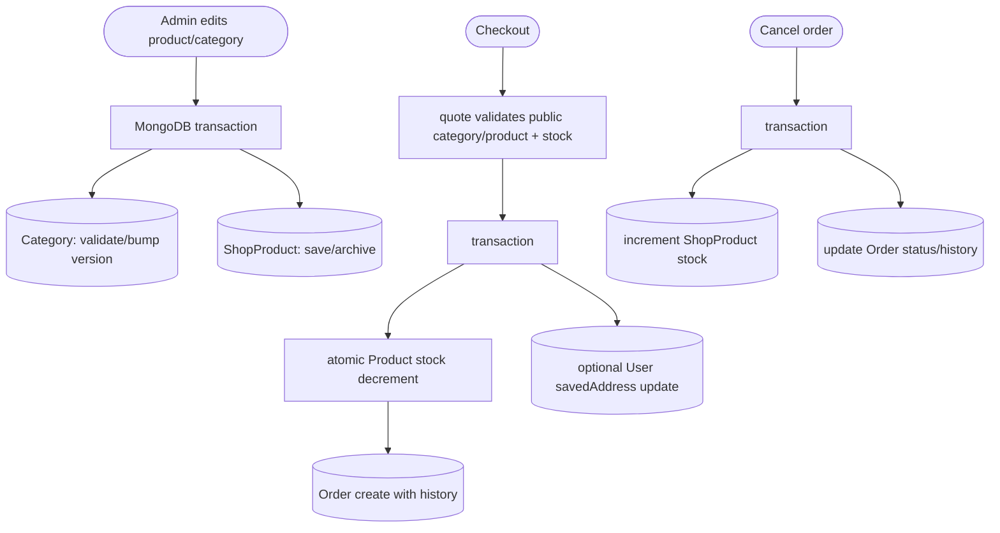

# Database Architecture

MongoDB is accessed through Mongoose. `connectDB()` reuses an open/pending connection; connection failures surface as API 503 responses. Transactions are used for product/category consistency, checkout inventory reservation, status cancellation/restock, and role changes.

## Collections

| Collection/model | Purpose and notable constraints |
|---|---|
| `User` | Accounts, role, session version, password hash, optional saved address; username/email unique. |
| `ShopProduct` | Sellable catalogue; unique slug, category slug, availability, visibility, price/sale price and stock. |
| `Category` | Unique slug/anchor, presentation and active state. Product-to-category association is by slug, not Mongo ObjectId. |
| `HomePage` | One document per `home`/`shop`, with content map, backgrounds and legacy educational plant array. |
| `Order` | User/order references, immutable-ish item snapshots, monetary paise fields, COD/order status/history; unique order ids and partial unique `(userId,idempotencyKey)` index. |
| `Media` | Cloudinary metadata; logical retirement rather than cloud deletion. |
| `Contact` | Form messages. |
| `AdminEvent` | Role lock/revision plus role-change audit events. |
| `RateLimit` | Hashed scope/IP/time-bucket counter with TTL `expiresAt`. |

## Data workflow

CRUD mapping: public catalogue/content reads query `ShopProduct`, `Category`, and `HomePage`; admin creates/updates/archives products, creates/updates/deletes categories, manages media and reads users; contact POST creates `Contact`; auth creates/reads/updates `User`; checkout reads products/categories then creates orders and may update a saved address. The server performs schema validation plus explicit input validation; it has no Mongoose lifecycle hooks or database triggers.
