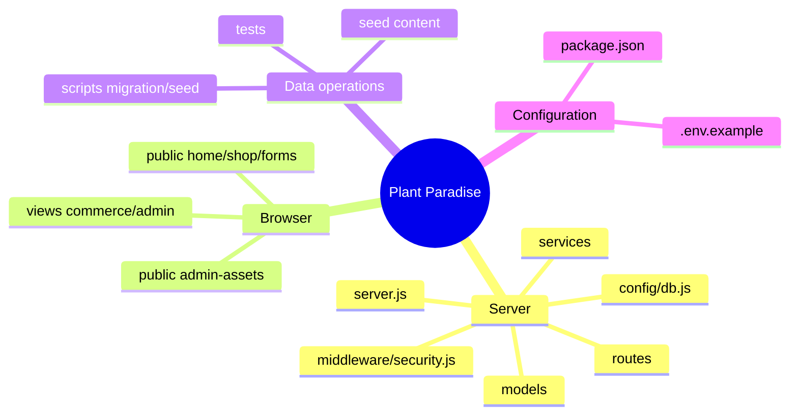

# Project Structure

```text
Plant_Paradise/
├── server.js                       Express entry point and middleware/route registration
├── package.json / package-lock.json dependency manifest and scripts
├── .env / .env.example             private runtime config / non-secret variable template
├── config/db.js                    lazy, de-duplicated MongoDB connection
├── middleware/security.js          origin checks, JWT auth, RBAC, rate limits, error adapter
├── models/                         Mongoose schemas and indexes
│   ├── User.js, Order.js, ShopProduct.js, Category.js
│   ├── HomePage.js, Media.js, Contact.js
│   └── AdminEvent.js, RateLimit.js
├── routes/                         Express route modules
│   ├── authRoutes.js               registration, session and logout
│   ├── catalogRoutes.js            public products/categories
│   ├── contentRoutes.js            public home/shop CMS payloads
│   ├── orderRoutes.js              authenticated quote, checkout and order reads
│   ├── contactRoutes.js            submit/read messages
│   ├── adminRoutes.js              protected CMS/admin APIs
│   └── adminCommerceRoutes.js      protected orders and role management
├── services/
│   ├── catalog.js                  filters, projection/presentation, validation helpers
│   ├── orders.js                   quote, delivery validation and status presentation
│   └── media.js                    Sharp + signed Cloudinary upload
├── public/                         express.static browser assets
│   ├── index.html, content.js      home page and CMS renderer
│   ├── Shop/                       shop page/cart interaction
│   ├── login/, register/, contact/ form-specific pages/scripts
│   ├── commerce.js / commerce.css  checkout, history and confirmation UI
│   ├── auth-state.js / cart.js     shared session display and local cart
│   └── admin-assets/               protected admin SPA-like renderer
├── views/admin.html                shell sent after server-side admin guard
├── views/commerce.html             shell for checkout, history and confirmation
├── seed/                           source content and historic page assets
├── scripts/                        seed, migration, promotion and live-content checks
├── tests/                          integration, UI, content and commerce smoke tests
└── ADMIN.md, CHECKOUT.md, CONTENT.md existing feature/operator notes
```

## Entrypoints and configuration

`server.js` is both the importable Express app and the executable listener (`PORT` or 3000). `config/db.js` reads `.env` and uses `MONGODB_URI`, with a local fallback; it may use `MONGODB_DNS_SERVERS`. Security uses `JWT_SECRET`, `APP_ORIGIN`, `NODE_ENV`, and `VERCEL`. Image upload is available only when the three Cloudinary configuration variables are present.

Frontend entry pages are `/` (`public/index.html`), `/Shop/`, `/login/`, `/register/`, `/contact/`, and the dynamic views `/checkout`, `/my-orders`, `/orders/confirmation/:id`, and guarded `/admin/*`.

## Folder map


